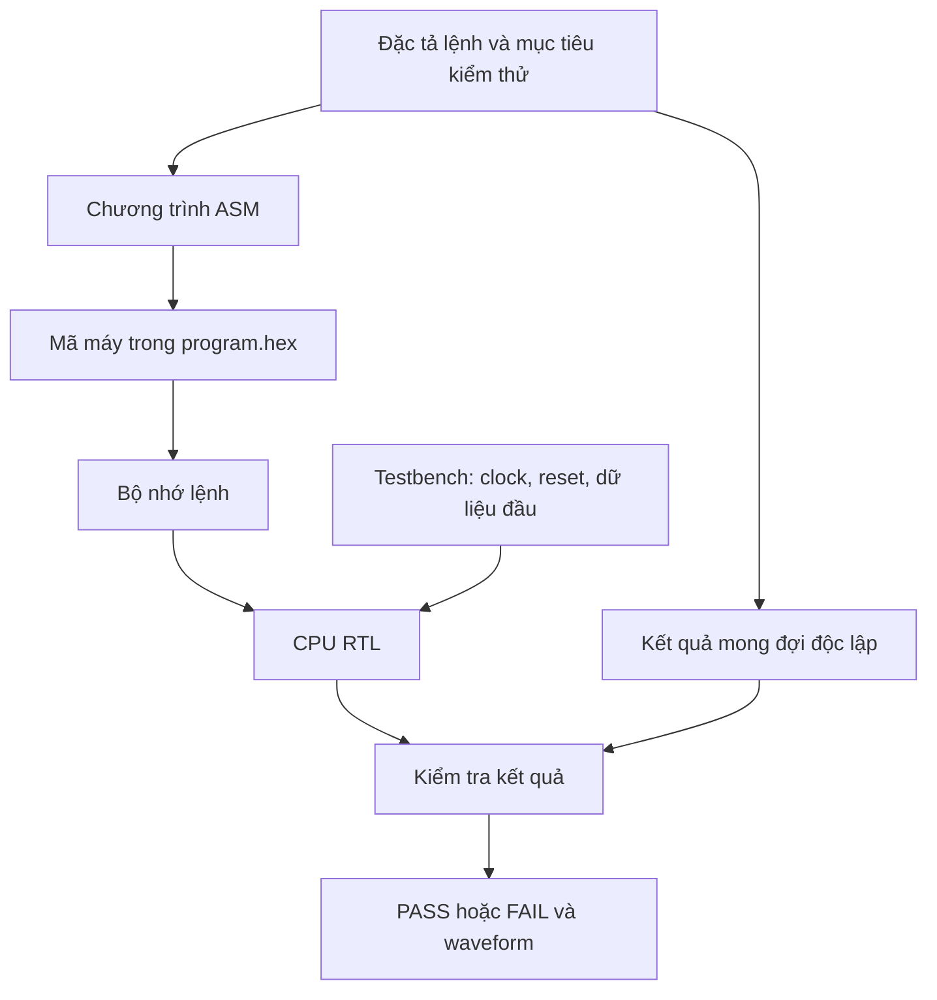

# Hướng dẫn dự án single-cycle ARM processor

Môn: **Thiết kế số và vi xử lý** · Cập nhật: **13/11/2026**

Tài liệu này dùng để tự học, triển khai kiểm thử và làm chỉ dẫn cho những lần hỗ trợ dự án tiếp theo. Các liên kết slide là những tài liệu đã được tìm thấy và đọc; ví dụ mã dưới đây là mẫu hướng dẫn, chưa phải code đã tích hợp vào repo.

## 1. Mục tiêu và phạm vi dự án

- Nhóm **3 người** cùng thiết kế CPU bằng **SystemVerilog**.
- CPU thực hiện các lệnh trong phạm vi đã thống nhất theo kiến trúc **single-cycle**.
- Sản phẩm được làm chung, **báo cáo viết cá nhân** để đánh giá mức độ hiểu.
- Viết testcase và testbench chạy trên **ModelSim**, ưu tiên ngắn gọn, tự kiểm tra và có điểm dừng.
- Hạn chế testcase lặp lại cùng một mục tiêu; mỗi trường hợp cần có lý do kiểm thử rõ ràng.
- **Testbench giữa các nhóm dự án phải khác nhau** về tình huống, chương trình lệnh hoặc cách kiểm chứng, dù logic CPU có thể tương tự. Đổi tên biến hoặc thay vài hằng số chưa tạo ra khác biệt về tư duy kiểm thử.
- Vấn đáp tập trung vào **báo cáo cá nhân và testbench**: phải giải thích được đầu vào, kết quả mong đợi, đường đi dữ liệu và tín hiệu điều khiển liên quan.

**Repo chính thức của dự án:** [SirNotFunny/SystemVerilogSingleCycleARMProcessor][repo].

**Tình trạng nguồn đã kiểm tra ngày 13/11/2026:** nhánh `main` có `README.md`, các slide DDCA ARM Chương 1–7 và sách ARM dạng PDF; chưa có file RTL `.sv`, testbench hay chương trình mã máy để xác nhận tên module, cổng và tập lệnh đã triển khai. Các tên file/cổng trong tài liệu này là đề xuất hoặc giao diện mẫu. Cần đối chiếu lại khi nhóm đưa code CPU lên repo.

## 2. ASM → 32 bit → testbench: hiểu đúng quy trình

Ý tưởng bắt đầu từ ASM rồi đổi sang mã máy 32 bit là đúng. Sau đó cần tách hai việc:

1. **Tạo chương trình kiểm thử:** mã máy được đưa vào instruction memory để CPU đọc và thực thi.
2. **Viết testbench:** tạo clock/reset, chuẩn bị bộ nhớ dữ liệu và kiểm tra kết quả CPU thực hiện chương trình đó.

**Mã máy là dữ liệu đầu vào của CPU. Testbench là môi trường kiểm chứng CPU.** Một chuỗi mã máy tự nó chưa chỉ ra PASS hay FAIL.



Ví dụ: muốn kiểm tra phép cộng `5 + 7`, chương trình tạo hai toán hạng và chạy `ADD`; testbench phải biết trước kết quả cần là **12**. Không lấy chính kết quả ALU của DUT làm giá trị mong đợi, vì như vậy có thể bỏ sót lỗi ALU.

## 3. Các slide cũ cần học và liên kết mở lại

**Cách đọc số trang:** các khoảng dưới đây tính theo thứ tự trang trong bản trích xuất của file. Số in ở chân slide có thể khác, nhất là Chương 2, 5 và 7; hãy dùng thêm tên mục để tìm.

| Thứ tự | Slide đã có | Phần cần đọc | Áp dụng vào CPU/testbench |
|---|---|---|---|
| 1 | [Chương 1 — nền tảng số][ch1] | Trang 12–24: binary, hex, độ rộng, cộng và overflow; 25–37: số có dấu, bù hai, sign/zero extension; 38–43: cổng logic | Đọc dữ liệu 32 bit, hiểu số âm, kiểm tra tràn và mở rộng immediate |
| 2 | [Chương 2 — combinational logic][ch2] | Trang 3–20: mạch tổ hợp, bảng chân trị, biểu thức Boolean; 136–140: mux, decoder; 141–143: độ trễ | Hiểu decoder chọn phép toán và mux chọn đường dữ liệu |
| 3 | [Chương 3 — sequential logic][ch3] | Trang 14–27: DFF, register, enable, reset; 28–42: FSM; 57–63: setup/hold và timing | Hiểu trạng thái CPU, cạnh clock, ghi register và thời điểm kiểm tra |
| 4 | [Chương 4 — SystemVerilog và testbench][ch4] | Trang 3–20: mô tả HDL và tổ hợp; 28–42: `always_ff`, `always_comb`, `=`, `<=`; 49: parameter; **50–62: testbench, tự kiểm tra, testvector** | Viết RTL và TB; học kỹ các trang 54–62 trước khi viết checker |
| 5 | [Chương 5 — digital building blocks][ch5] | Trang 4–26: adder, subtractor, comparator, ALU; 29–43: ALU và flags; 44–47: shifter | Hiểu khối tính toán và phân biệt carry với signed overflow |
| 6 | [Chương 5 — memory, LUT và FPGA][ch5] | Trang 85–101: memory/RAM; 104: ROM bằng HDL; **107–113: logic bằng bộ nhớ/LUT**; **114–116: multi-port memory/register file**; **120–129: FPGA, LE và design flow** | Hiểu instruction/data memory, register file, LUT và quá trình tổng hợp lên FPGA |
| 7 | [Chương 6.1 — instruction set][ch6-1] | Trang 9–25: ADD/SUB, registers, immediate; 26–36: memory, LDR/STR, byte/word, endianness | Đọc ASM và xác định lệnh phải thay đổi trạng thái nào |
| 8 | [Chương 6.2a — logic, điều kiện và branch][ch6-2a] | Trang 3–8: logic/shift; **11–19: NZCV và conditional execution**; **21–24: branch** | Thiết kế kiểm thử flags, điều kiện đúng/sai, nhảy và không nhảy |
| 9 | [Chương 6.3 — instruction encoding][ch6-3] | **Trang 5–17: định dạng và DP immediate**; 18–31: register/shift; 33–46: memory; **48–55: branch, imm24 và cond**; 56–62: giải mã ngược | Đổi ASM thành mã máy; giải thích từng trường bit khi vấn đáp |
| 10 | [Chương 6.4 — addressing modes][ch6-4] | Trang 3–9: register/immediate/base addressing; **11–13: PC-relative và stored program** | Phân biệt địa chỉ, dữ liệu, offset và chương trình nằm trong bộ nhớ |
| 11 | [Chương 7 — microarchitecture, bản (1)][ch7] | **Trang 9–33: state và datapath**; **37–55: decoder/control**; **57–71: conditional logic/flags**; 72–79: ví dụ và mở rộng; 80–85: performance | Nối trực tiếp ASM, trường bit, control signals và các khối CPU |
| Đọc thêm | [Chương 6.2b — high-level constructs và function calls][ch6-2b] | Trang 2–20: if/loop; 22–27: array; 31–58: function, stack | Dùng khi cần chương trình kiểm thử có vòng lặp hoặc đã mở rộng CPU; function call/stack chưa phải ưu tiên của bản cơ sở |

Cũng có [bản Chương 7 không có hậu tố (1)][ch7-alt]. Dùng một bản xuyên suốt khi ghi số trang trong báo cáo.


### Liên kết tài liệu trên GitHub để dùng chung trong nhóm

Các file dưới đây hiện có trong repo chính thức. Khoảng trang ở bảng phía trên dựa trên các bản slide đã đọc; nếu file được thay hoặc sửa, tìm thêm theo tên mục và đối chiếu lại số trang.

| Tài liệu | Liên kết trong repo |
|---|---|
| Chương 1 — nền tảng số | [Mở trên GitHub](https://github.com/SirNotFunny/SystemVerilogSingleCycleARMProcessor/blob/main/DDCAarm_Ch1.pptx) |
| Chương 2 — combinational logic | [Mở trên GitHub](https://github.com/SirNotFunny/SystemVerilogSingleCycleARMProcessor/blob/main/DDCAarm_Ch2.pptx) |
| Chương 3 — sequential logic | [Mở trên GitHub](https://github.com/SirNotFunny/SystemVerilogSingleCycleARMProcessor/blob/main/DDCAarm_Ch3.pptx) |
| Chương 4 — SystemVerilog/testbench | [Mở trên GitHub](https://github.com/SirNotFunny/SystemVerilogSingleCycleARMProcessor/blob/main/DDCAarm_Ch4.pptx) |
| Chương 5 — building blocks, memory, LUT/FPGA | [Mở trên GitHub](https://github.com/SirNotFunny/SystemVerilogSingleCycleARMProcessor/blob/main/DDCAarm_Ch5.pptx) |
| Chương 6.1 — instruction set | [Mở trên GitHub](https://github.com/SirNotFunny/SystemVerilogSingleCycleARMProcessor/blob/main/DDCAarm_Ch6%20-%201%20-%20instruction%20set.pptx) |
| Chương 6.2a — data processing, conditional/branch | [Mở trên GitHub](https://github.com/SirNotFunny/SystemVerilogSingleCycleARMProcessor/blob/main/DDCAarm_Ch6%20-%202a%20-%20data%20processing%20and%20conditional%20and%20branch%20executions.pptx) |
| Chương 6.2b — high-level constructs/function calls | [Mở trên GitHub](https://github.com/SirNotFunny/SystemVerilogSingleCycleARMProcessor/blob/main/DDCAarm_Ch6%20-%202b%20-%20high%20level%20construct%20and%20function%20calls.pptx) |
| Chương 6.3 — encoding 32 bit | [Mở trên GitHub](https://github.com/SirNotFunny/SystemVerilogSingleCycleARMProcessor/blob/main/DDCAarm_Ch6%20-%203%20-%20instruction%20encoding.pptx) |
| Chương 6.4 — addressing modes | [Mở trên GitHub](https://github.com/SirNotFunny/SystemVerilogSingleCycleARMProcessor/blob/main/DDCAarm_Ch6%20-%204%20-%20address%20modes.pptx) |
| Chương 6 — bản tổng hợp | [Mở trên GitHub](https://github.com/SirNotFunny/SystemVerilogSingleCycleARMProcessor/blob/main/DDCAarm_Ch6.pptx) |
| Chương 7 — microarchitecture/single-cycle | [Mở trên GitHub](https://github.com/SirNotFunny/SystemVerilogSingleCycleARMProcessor/blob/main/DDCAarm_Ch7.pptx) |

### Lộ trình học có điểm dừng

| Chặng | Học và làm | Có thể chuyển tiếp khi… |
|---|---|---|
| A | Ch1 → Ch2 → phần DFF/register của Ch3 | Đổi được hex/binary, hiểu mux, phân biệt tổ hợp và tuần tự |
| B | Ch4 → Ch5: ALU, RAM, register file | Viết được một TB nhỏ có expected value và PASS/FAIL |
| C | Ch6.1 → Ch6.2a → Ch6.3 → Ch6.4 | Mã hóa và giải mã được một ADD, một STR và một B |
| D | Ch7, từ datapath đến conditional logic | Theo dấu được một lệnh qua các khối và giải thích control signals |
| E | Chốt tập lệnh → lập bảng testcase → viết chương trình ngắn | Tính được trạng thái mong đợi mà chưa cần chạy DUT |
| F | Viết checker → chạy ModelSim → ghi bằng chứng | Phát hiện được lỗi, báo đúng ca lỗi và giải thích được waveform |

Chưa cần học hết multicycle/pipeline để hoàn thành bản single-cycle. Phần FSM giúp hiểu trạng thái; bản single-cycle cơ sở không cần một FSM điều khiển nhiều chu kỳ để lần lượt chạy fetch/decode/execute.

## 4. “32 bit”, logic và LUT liên quan nhau thế nào?

### 4.1. Phân biệt những đối tượng cùng có thể rộng 32 bit

| Đối tượng | Ví dụ | Ý nghĩa |
|---|---|---|
| Dữ liệu | `32'h0000000C` | Giá trị 12 có thể nằm trong register hoặc RAM |
| Mã lệnh | `32'hE0813002` | Các trường bit yêu cầu thực hiện `ADD R3, R1, R2` |
| Địa chỉ | `32'h00000040` | Vị trí byte 64; nếu RAM tổ chức theo word thì tương ứng phần tử số 16 |
| Bus | `logic [31:0] WriteData` | 32 đường tín hiệu mang một giá trị tại mỗi thời điểm |

Binary và hex là hai cách viết **cùng một mẫu bit**. Một chữ số hex biểu diễn 4 bit; 8 chữ số hex biểu diễn 32 bit. Không phải mọi hằng immediate đều có đủ 32 bit nằm trực tiếp trong lệnh: các bit còn lại phải chứa opcode, số register và các trường điều khiển.

Với dữ liệu bù hai 32 bit:

- Miền unsigned: `0` đến `2^32 - 1`.
- Miền signed: `-2^31` đến `2^31 - 1`.
- `32'hFFFFFFFF` là `4294967295` nếu đọc unsigned, và `-1` nếu đọc signed.
- `32'h7FFFFFFF + 1 = 32'h80000000`: tràn signed, chưa có carry ra bit 32.
- `32'hFFFFFFFF + 1 = 32'h00000000`: có carry, không tràn signed khi hiểu phép cộng là `-1 + 1`.

### 4.2. LUT không phải bảng đổi ASM sang binary

Một **look-up table** có thể lưu đầu ra cho mỗi tổ hợp đầu vào của hàm logic. Ví dụ `Y = A & B`:

| A | B | Y |
|---|---|---|
| 0 | 0 | 0 |
| 0 | 1 | 0 |
| 1 | 0 | 0 |
| 1 | 1 | 1 |

Nếu coi `{A,B}` là địa chỉ 0–3, bốn bit lưu tương ứng là `0,0,0,1`. Trong mô hình khái niệm `Y = table[{A,B}]`, có thể viết `table = 4'b1000`. Đây là cách giải thích logic, chưa phải cách ghi bitstream cụ thể của nhà sản xuất.

Trong FPGA, công cụ tổng hợp ánh xạ nhiều hàm tổ hợp vào LUT và dùng flip-flop để lưu trạng thái. **Một ALU 32 bit được tạo bởi nhiều tài nguyên logic**, không phải một LUT nhỏ chứa mọi phép toán 32 bit. Nếu triển khai trên MAX 10/DE10-Lite, tài liệu chính thức mô tả LE có LUT 4 đầu vào, register và carry chain; xem [tài liệu MAX 10][max10].

Phân biệt ba loại “bảng” thường gặp:

| Bảng | Dùng ở đâu? | Dùng để làm gì? |
|---|---|---|
| Bảng encoding | Khi viết/đọc mã máy | Xác định bit nào biểu diễn lệnh, register, immediate |
| Bảng điều khiển | Khi thiết kế controller | Từ trường lệnh sinh `RegWrite`, `ALUSrc`, `MemWrite`… |
| LUT của FPGA | Khi ánh xạ RTL lên phần cứng | Thực hiện các hàm logic bằng tài nguyên cấu hình được |

## 5. Các thành phần CPU cần hiểu

| Khối | Nhiệm vụ | Điều cần giải thích hoặc kiểm tra |
|---|---|---|
| PC register | Giữ địa chỉ lệnh hiện tại | Reset về đâu? Khi nào tăng 4? Khi nào nhận địa chỉ nhảy? |
| Instruction memory | Từ PC đọc ra mã lệnh | Chỉ số mảng là byte hay word? Đọc tổ hợp hay có trễ clock? |
| Register file | Đọc toán hạng, ghi kết quả | Địa chỉ register thường 4 bit; dữ liệu 32 bit; read/write ở thời điểm nào? |
| Immediate extender | Tạo toán hạng 32 bit từ trường immediate | DP dùng imm8; memory dùng imm12; branch dùng imm24 có dấu và dịch 2 bit trong bản cơ sở |
| ALU | ADD, SUB, AND, ORR | Phép toán, thứ tự toán hạng, kết quả và NZCV |
| Data memory | Thực hiện load/store | `address = base + offset`; STR ghi giá trị nào? LDR ghi về register nào? |
| Multiplexers | Chọn nguồn dữ liệu | Register/immediate, ALU/memory, PC+4/branch target |
| Decoder/controller | Giải mã các trường lệnh | Tín hiệu nào được bật cho từng loại lệnh? |
| Condition/flags logic | Quyết định lệnh có hiệu lực và cập nhật flags | Điều kiện sai phải chặn các tác động ghi; flags được giữ hay cập nhật? |

Nối với các bài lab đã học: **mux/ALU → datapath; DFF có reset/enable → PC và register; RAM → data memory; FSM → tư duy trạng thái và clock**. Đây là liên hệ khái niệm; vẫn cần đối chiếu độ rộng và giao diện khi dùng lại module.

**Single-cycle:** giữa hai cạnh clock liên tiếp, các khối tổ hợp đọc/giải mã/tính toán; tại cạnh chốt, các phần tử trạng thái nhận kết quả. Các bước mô tả một lệnh không có nghĩa mỗi bước chiếm một chu kỳ riêng.

`PC + 4` là địa chỉ lệnh tuần tự kế tiếp đối với chuỗi A32 trong mô hình này. Giá trị đọc kiến trúc của R15 và cơ sở tính branch là `PC + 8` theo thiết kế ARM đang học. Hai giá trị có mục đích khác nhau, cần theo đúng Ch7 và RTL thực tế.

## 6. Chốt tập lệnh trước khi viết testcase

**Mốc tham chiếu:** trang 11 của [Ch7][ch7] mô tả tập lệnh cơ sở sau. Đây là phạm vi trong slide, chưa phải xác nhận code của nhóm đã hỗ trợ đầy đủ.

| Nhóm | Phạm vi cơ sở trong slide | Phải kiểm tra trong RTL |
|---|---|---|
| Data processing | `ADD`, `SUB`, `AND`, `ORR`; Src2 là register hoặc immediate; không shift register | Opcode, lựa chọn Src2, cách mở rộng immediate, S-bit và flags |
| Memory | `LDR`, `STR`, positive immediate offset | Đọc/ghi word, base+offset, read latency, địa chỉ hợp lệ |
| Branch | `B` | PC-relative target, sign extension, dịch trái 2 bit, xử lý điều kiện |

Ch7 trang 27–33 dùng DP immediate dạng **zero-extend imm8**. Ch6.3 trang 12–17 trình bày thêm dạng A32 **imm8 xoay phải `2 × rot`**. Nếu RTL chỉ lấy `Instr[7:0]`, cần giữ `rot = 0`, dùng DP immediate trong khoảng `0..255`, hoặc triển khai và kiểm thử phần mở rộng trước khi dùng hằng có rotation.

`MOV`, `CMP`, `MUL`, `EOR`, `BL`, các lệnh byte, shift và indexing phức tạp có thể xuất hiện trong bài ASM nhưng **không nằm trọn trong danh sách cơ sở trên**. Ch7 trang 74–79 có phần mở rộng CMP và shifted register. Chỉ dùng các chức năng đó khi đặc tả và RTL đã có. Với memory word, chọn địa chỉ chia hết cho 4 trong vùng RAM được cấp.

Trước khi sinh chương trình, ghi một bảng ngắn: **lệnh hỗ trợ — dạng toán hạng — flags — addressing mode — giới hạn bộ nhớ**.

## 7. Ví dụ đầy đủ: một lệnh ASM thành 32 bit

Giả sử trước lệnh: `R1 = 5`, `R2 = 7`.

```asm
ADD R3, R1, R2
```

Kết quả kiến trúc cần có: `R3 = 12`, PC chuyển tới lệnh tuần tự tiếp theo; S-bit bằng 0 nên status flags được giữ nguyên.

| Trường | Bit | Giá trị | Ý nghĩa |
|---|---|---|---|
| cond | 31:28 | `1110` | AL, thực hiện vô điều kiện |
| op | 27:26 | `00` | Data processing |
| I | 25 | `0` | Src2 từ register |
| opcode/cmd | 24:21 | `0100` | ADD |
| S | 20 | `0` | Không cập nhật status flags |
| Rn | 19:16 | `0001` | R1 |
| Rd | 15:12 | `0011` | R3 |
| Shift fields | 11:4 | `00000000` | Không dịch |
| Rm | 3:0 | `0010` | R2 |

Ghép thành cùng một mã lệnh ở hai cách viết:

```systemverilog
32'b1110_0000_1000_0001_0011_0000_0000_0010
32'hE0813002
```

Khi giải thích datapath: register file đọc R1/R2 → mux chọn dữ liệu register → ALU cộng → mux writeback chọn ALUResult → ghi R3. Trong quy ước Ch7: `ALUSrc = 0`, `ALUControl = 00`, `RegWrite = 1`, `MemWrite = 0`, `MemtoReg = 0`, `PCSrc = 0`. Tên và mã hóa tín hiệu cần đối chiếu với code nhóm.

### Branch: công thức cần nhớ

Với lệnh B trong mô hình này, gọi `A` là địa chỉ byte của chính lệnh branch, `T` là địa chỉ đích:

```text
imm24_signed = (T - (A + 8)) / 4
T = A + 8 + sign_extend(imm24 << 2)
```

Đích cần word-aligned và offset cần nằm trong miền biểu diễn có dấu. Khi viết RTL cho toán hạng 32 bit, có thể biểu diễn phần offset là `{{6{Instr[23]}}, Instr[23:0], 2'b00}`.

Ví dụ `B` về chính nó: `(A - (A + 8))/4 = -2`; trường imm24 là `0xFFFFFE`, cả lệnh AL là `0xEAFFFFFE`. Đây là vòng lặp vô hạn của chương trình; testbench vẫn phải có timeout hoặc điều kiện kết thúc.

## 8. Tạo chương trình kiểm thử ngắn

Ví dụ sau kiểm tra đường đi **khởi tạo → ADD → STR → LDR → STR**. Giả định CPU đọc R15 theo `PC + 8`, instruction/data memory là các mảng word và PC bắt đầu ở 0.

| Địa chỉ byte | ASM | Mã máy 32 bit | Kết quả mong đợi sau khi hoàn tất lệnh |
|---|---|---|---|
| `0x00` | `SUB R0, R15, R15` | `E04F000F` | R0 = 0, không phụ thuộc giá trị ban đầu của các register thông thường |
| `0x04` | `ADD R1, R0, #5` | `E2801005` | R1 = 5 |
| `0x08` | `ADD R2, R0, #7` | `E2802007` | R2 = 7 |
| `0x0C` | `ADD R3, R1, R2` | `E0813002` | R3 = 12 |
| `0x10` | `STR R3, [R0, #64]` | `E5803040` | RAM tại địa chỉ byte 64 nhận 12 |
| `0x14` | `LDR R4, [R0, #64]` | `E5904040` | R4 = 12 |
| `0x18` | `STR R4, [R0, #68]` | `E5804044` | RAM tại địa chỉ byte 68 nhận 12 |
| `0x1C` | `B` về chính lệnh tại `0x1C` | `EAFFFFFE` | Giữ chương trình trong vùng hợp lệ nếu tiếp tục chạy |

Nội dung `program.hex`, mỗi dòng là một word lệnh:

```text
E04F000F
E2801005
E2802007
E0813002
E5803040
E5904040
E5804044
EAFFFFFE
```

Nạp bằng `$readmemh("program.hex", imem, 0, 7)`. Trong file dữ liệu này chỉ cần các chữ số hex; không viết tiền tố `32'h` như hằng trong source SystemVerilog. Nếu dùng chuỗi 32 ký tự `0/1` cho mỗi word thì dùng `$readmemb`.

**Byte và word:** `PC = 0x0C` đọc `imem[3]`; địa chỉ data `0x40` ứng với `dmem[16]`. Với mảng word 32 bit và địa chỉ word-aligned, chỉ số là `address[31:2]`. Mỗi dòng trên là cả một word lệnh, không phải từng byte theo thứ tự little-endian.

Có thể mã hóa thủ công vài lệnh đại diện để học và đối chiếu. Khi dùng assembler cho nhiều lệnh, chọn encoding **A32** phù hợp, kiểm tra disassembly và tập lệnh hỗ trợ; một công cụ chuyển đổi không thay cho việc kiểm tra CPU có thực thi dạng lệnh đó hay không.

## 9. Testbench tự kiểm tra: cấu trúc mẫu

### Giao diện giả định

Ví dụ dùng một core tên `arm` với các cổng `clk`, `reset`, `PC`, `Instr`, `MemWrite`, `ALUResult`, `WriteData`, `ReadData`. Đây là **hợp đồng giao diện mẫu**, chưa được xác nhận trong repo. Nếu top-level của nhóm đã chứa instruction/data memory thì dùng bộ nhớ sẵn có và sửa cách nạp/quan sát, tránh tạo thêm bản sao bộ nhớ bên ngoài.

Mẫu dùng instruction memory/data read tổ hợp và data write ở cạnh lên, phù hợp giả định single-cycle đang học.

```systemverilog
`timescale 1ns/1ps
module cpu_tb;
  logic clk = 0, reset = 1;
  logic [31:0] PC, Instr, ALUResult, WriteData, ReadData;
  logic MemWrite;
  logic [31:0] imem [0:63], dmem [0:63];
  int stores = 0;

  arm dut (.clk(clk), .reset(reset), .PC(PC), .Instr(Instr),
           .MemWrite(MemWrite), .ALUResult(ALUResult),
           .WriteData(WriteData), .ReadData(ReadData));

  always #5 clk = ~clk;
  assign Instr = imem[PC[31:2]];
  assign ReadData = dmem[ALUResult[31:2]];

  initial begin
    for (int i = 0; i < 64; i++) begin
      imem[i] = 32'hEAFFFFFE;
      dmem[i] = 0;
    end
    $readmemh("program.hex", imem, 0, 7);
    repeat (2) @(negedge clk);
    reset = 0;

    repeat (20) begin
      @(posedge clk); #1;
      if (stores == 2) begin
        if (dmem[16] !== 32'd12 || dmem[17] !== 32'd12)
          $fatal(1, "FAIL: committed memory result");
        $display("PASS: ADD/STR/LDR example");
        $finish;
      end
    end
    $fatal(1, "FAIL: timeout, stores=%0d", stores);
  end

  always @(posedge clk) begin
    if (!reset) begin
      if (MemWrite !== 1'b0 && MemWrite !== 1'b1)
        $fatal(1, "FAIL: unknown MemWrite");
      if (MemWrite) begin
        if (stores >= 2)
          $fatal(1, "FAIL: unexpected extra store");
        if (ALUResult !== (32'd64 + 4*stores) || WriteData !== 32'd12)
          $fatal(1, "FAIL: store %0d addr=%h data=%h",
                 stores, ALUResult, WriteData);
        dmem[ALUResult[31:2]] <= WriteData;
        stores = stores + 1;
      end
    end
  end
endmodule
```

**Cách đọc:** checker quan sát giao dịch store tại cạnh lên, trước khi PC/register thay đổi bởi nonblocking assignments. Kiểm tra nội dung RAM sau `#1` để chờ cập nhật NBA. Không chèn cùng độ trễ đó vào monitor store rồi vô tình đọc bus của lệnh kế tiếp.

`!==` giúp coi cả X/Z là sai so với một expected value xác định. Testbench đổi reset ở cạnh xuống để tránh tranh chấp với logic chốt cạnh lên. Chu kỳ 10 ns ở đây là lựa chọn mô phỏng chức năng, chưa chứng minh CPU chạy được 100 MHz trên FPGA.

Mẫu chỉ kiểm tra chuỗi ADD/STR/LDR này, có giới hạn 20 chu kỳ sau reset. Nó kết thúc sau store thứ hai, **chưa kiểm chứng lệnh B ở cuối**, chưa kiểm thử flags, reset giữa chương trình hay mọi lỗi có thể xảy ra. Muốn quan sát từng register ngay sau mỗi lệnh, bổ sung một giao diện debug hoặc checkpoint đọc register phù hợp với thiết kế; số 12 ở đầu ra chỉ chứng minh các tác động được checker này quan sát.

## 10. Chọn testcase để ít overlap nhưng có ý nghĩa

Mỗi dòng dưới đây là một mục tiêu kiểm chứng; một mục tiêu có thể cần vài lệnh chuẩn bị. Có thể dùng lại chuỗi khởi tạo và hàm kiểm tra. Tránh tạo nhiều bản TB chỉ để lặp lại cùng một phép cộng với các số nhỏ khác nhau.

| ID | Mục tiêu | Tình huống điển hình | Điều phải kiểm tra |
|---|---|---|---|
| R0 | Reset và tuần tự | Assert reset qua cạnh clock; sau đó chạy lệnh bình thường | PC về địa chỉ reset; PC tiếp tục tăng 4; hành vi RF/flags đúng đặc tả reset, không mặc định mọi register đều về 0 |
| D1 | Chọn Src2 | ADD dạng register và immediate với nguồn đã biết | Đúng register/immediate và đúng register đích |
| D2 | SUB và thứ tự toán hạng | `5 - 7` | Kết quả `FFFFFFFE`, không bị đảo A/B |
| D3 | Chọn phép logic | AND và ORR với `A5`, `3C` | AND = `24`; ORR = `BD`, không chỉ chọn mẫu toàn 0 |
| F1 | Zero/negative flags | SUBS hai giá trị bằng nhau; phép trừ ra âm | Z/N đúng với từng kết quả |
| F2 | Carry | ADDS `FFFFFFFF + 1` | Result = 0, C = 1, V = 0 |
| F3 | Signed overflow | ADDS `7FFFFFFF + 1` | Result = `80000000`, V = 1, C = 0 |
| F4 | Điều kiện cập nhật flags | Tạo flags bằng lệnh S=1, sau đó chạy lệnh S=0 | Flags đã lưu không bị ghi đè; với ANDS/ORRS bản cơ sở, kiểm tra NZ và giữ CV theo thiết kế |
| M1 | Địa chỉ và dữ liệu STR | Base = 32, offset = 12 | Chỉ địa chỉ byte 44 nhận dữ liệu cần ghi; tránh chỉ test base bằng 0 |
| M2 | Đường writeback LDR | RAM có trước mẫu khác 0, load về register rồi xuất ra checkpoint | Lấy dữ liệu từ memory và ghi đúng đích, không nhầm lấy ALUResult |
| B1 | Branch tiến | B nhảy qua một STR có tác dụng dễ phát hiện | PC đến đúng đích; STR bị bỏ qua không xảy ra |
| B2 | Branch lùi và dấu | Vòng lặp hữu hạn dùng SUBS giảm bộ đếm và BNE | Nhảy lùi đúng, sign extension đúng và cuối cùng thoát vòng lặp |
| C1 | Điều kiện đúng/sai | Tạo Z xác định rồi chạy lệnh EQ/NE, gồm một lệnh store có điều kiện sai | Lệnh đúng có tác dụng; lệnh sai không ghi RF/RAM/flags và vẫn đi tới PC tuần tự |

F2/F3 có thể kiểm tra ở cấp ALU trước, rồi kiểm tra việc lưu flags ở cấp CPU. Để tạo toán hạng lớn trong chương trình, có thể chuẩn bị dữ liệu RAM rồi LDR; không cần dùng MOV hoặc phép shift chưa được triển khai.

Đối với B1/C1, **chờ một cửa sổ quan sát đủ dài và kiểm tra không xuất hiện tác động bị cấm**. Không chỉ nhận được một tín hiệu thành công sớm rồi kết thúc trước đoạn lẽ ra phải bị bỏ qua.

### Phân chia cho 3 thành viên

Đây là gợi ý tổ chức phạm vi, cần chốt theo code và yêu cầu giảng viên:

| Thành viên | Phần kiểm thử phụ trách chính | Trọng tâm báo cáo cá nhân |
|---|---|---|
| Dũng | Data processing và flags | ALU, Src2, opcode, S-bit, carry/overflow |
| Đạt | LDR/STR và memory | Địa chỉ byte/word, base+offset, RegSrc cho STR, memory write/read và writeback |
| Khánh | Branch, conditional execution và PC | PC+4/PC+8, imm24, CondEx, chặn tác động ghi |

Reset, khởi tạo, giao diện chung và chạy tích hợp là phần cùng thống nhất. Mỗi người vẫn cần hiểu toàn bộ CPU ở mức đi theo được một lệnh; báo cáo cá nhân phải thể hiện cách lý giải và bằng chứng kiểm thử của người viết.

Sự khác nhau giữa các **nhóm dự án** nên đến từ kịch bản và mục tiêu kiểm thử thực sự: một nhóm dùng chuỗi tính toán rồi load/store, nhóm khác dùng thao tác mask trên mảng, nhóm khác dùng vòng lặp có nhánh. Tất cả vẫn phải chứng minh các chức năng được yêu cầu.

## 11. Cách tổ chức file và chạy ModelSim

| File đề xuất | Vai trò |
|---|---|
| Các file RTL `.sv` | CPU và các khối con; tên/path do nhóm thống nhất |
| `rtl.f` | Liệt kê các file RTL thực sự cần compile, mỗi dòng một đường dẫn |
| `program.s` | Chương trình ASM để con người đọc và giải thích |
| `program.hex` | Các word mã máy để instruction memory đọc |
| `cpu_tb.sv` | Clock/reset, memory model nếu cần, checker và timeout |
| `run.do` | Lệnh compile, load simulation và chạy |
| Báo cáo cá nhân | Đặc tả, giải thích thiết kế, testcase, kết quả và giới hạn |

Ví dụ lệnh ở Transcript sau khi đã tạo RTL và sửa giao diện TB cho khớp; đường dẫn thư mục dưới đây là **đề xuất**:

```tcl
cd {D:/UniSources/ThietKeSoVaViXuLi/ARM_Final}
vlib work
vmap work work
vlog -sv -f rtl.f cpu_tb.sv
vsim -voptargs=+acc work.cpu_tb
add wave sim:/cpu_tb/clk sim:/cpu_tb/reset
add wave sim:/cpu_tb/PC sim:/cpu_tb/Instr
add wave sim:/cpu_tb/MemWrite sim:/cpu_tb/ALUResult
add wave sim:/cpu_tb/WriteData sim:/cpu_tb/ReadData
run -all
```

`program.hex` được tìm theo thư mục làm việc của simulation. Nếu dùng top/TB khác, sửa tên ở `vsim` và đường dẫn `sim:/...`. Khi `work` đã tồn tại có thể bỏ qua bước tạo lại. Với package SystemVerilog, xếp file package trước các module sử dụng nó trong `rtl.f`.

Testbench không được tổng hợp thành CPU trên FPGA. Program HEX chứa lệnh CPU thực thi; file cấu hình FPGA do Quartus tạo chứa cấu hình phần cứng. Giữ rõ hai loại file này khi giải thích design flow.

Nếu triển khai lên FPGA thật, cần kiểm tra loại RAM được suy diễn, read latency và timing. Mô hình RAM đọc tổ hợp có thể phù hợp với bài single-cycle, trong khi RAM block có đọc đồng bộ sẽ thay đổi giả định về chu kỳ. Kết quả mô phỏng chức năng cần được phân biệt với timing closure sau tổng hợp/place-and-route.

## 12. Ghi báo cáo và chuẩn bị vấn đáp

Mỗi testcase nên có một dòng hồ sơ:

| ID | Mục tiêu | Trạng thái đầu | ASM/hex | Expected | Kết quả thực tế | Bằng chứng |
|---|---|---|---|---|---|---|
| Ví dụ D1 | ADD register | R1=5, R2=7 | `ADD R3,R1,R2` / `E0813002` | R3=12; flags giữ nguyên | Điền sau khi chạy | Log/checkpoint và waveform cần thiết |

Báo cáo cá nhân có thể theo thứ tự: phạm vi tập lệnh → sơ đồ khối → nguyên lý một lệnh mỗi nhóm → bảng testcase → cách tự kiểm tra trong TB → kết quả đã chạy → giới hạn còn lại → tài liệu tham khảo. Dùng một vài waveform tiêu biểu để giải thích, kèm bảng kết quả cho toàn bộ bộ test; tránh chụp hàng loạt sóng mà không chỉ ra đang chứng minh điều gì.

Tự trả lời được các câu hỏi sau:

1. Vì sao cùng 32 bit nhưng instruction và data được hiểu khác nhau?
2. Lấy các trường Rn, Rd, Rm, opcode và cond ở đâu trong lệnh ví dụ?
3. Vì sao ADD register và ADD immediate dùng chung ALU nhưng khác lựa chọn mux?
4. STR lấy register dữ liệu từ trường nào, và khác register base thế nào?
5. Vì sao địa chỉ byte 64 lại là phần tử RAM số 16?
6. PC+4 và PC+8 được dùng ở đâu? Tính một branch tiến/lùi như thế nào?
7. Flags nào đổi khi S=1? Điều kiện sai thì các tác động ghi bị chặn ra sao?
8. Vì sao quan sát bus tại cạnh clock khác với đọc register ngay sau cập nhật NBA?
9. Testbench này phát hiện những lỗi gì, và còn bỏ sót những gì?
10. Nếu RAM đọc có trễ một chu kỳ thì thiết kế single-cycle phải xem xét lại phần nào?

## 13. Chỉ dẫn cho những lần hỗ trợ dự án tiếp theo

- Đọc đặc tả và RTL hiện có trước khi khẳng định CPU hỗ trợ lệnh/dạng immediate nào. Dùng tập lệnh Ch7 làm mốc tham chiếu khi chưa có code.
- Khi cần học lại kiến thức, liên kết đúng slide ở mục 3, chỉ rõ phần liên quan và giải thích bằng một ví dụ nhỏ.
- Trình bày một lệnh theo thứ tự: **ASM → trạng thái mong đợi → trường bit → control signals → datapath → điểm kiểm tra trong TB**.
- Với mỗi testcase, giải thích lý do chọn dữ liệu và lỗi mà ca đó có thể phát hiện. Kết quả mong đợi phải tính độc lập từ ý nghĩa lệnh.
- Ưu tiên TB tự kiểm tra, dùng lại helper khi có nhiều ca, có thông báo lỗi rõ và giới hạn thời gian. Tránh thêm framework phức tạp khi bài tập chưa cần.
- Chỉ dùng đường dẫn hierarchy và tên module đã xác minh. Với ví dụ giả định, ghi rõ giao diện và các chỗ cần sửa.
- Phân biệt test ở cấp khối, cấp CPU và kiểm tra trên FPGA; phân biệt bus đang thực hiện giao dịch với trạng thái đã được chốt.
- Giữ phạm vi kiểm thử giữa các thành viên rõ ràng, đồng thời cho phép các lệnh phụ trợ dùng chung. Tình huống liên nhóm chức năng có thể cần thiết để kiểm tra tương tác.
- Báo cáo/testbench của mỗi nhóm cần có tình huống và lập luận riêng; giải thích sự khác biệt bằng mục tiêu kiểm thử thực tế.
- Luôn hướng tới việc người viết tự giải thích được báo cáo và TB khi vấn đáp. Không ghi kết quả PASS, khả năng chạy ModelSim hay khả năng chạy FPGA nếu chưa có bằng chứng thực thi tương ứng.

## 14. Tài liệu tham khảo bổ sung

Các slide môn học ở mục 3 là nguồn chính. Khi cần đối chiếu thêm:

- [Trang tài nguyên DDCA ARM của tác giả][ddca]: có các gói lecture slides, HDL và labs. Dùng làm tài liệu tham khảo và đối chiếu, kiểm tra với phiên bản môn học trước khi áp dụng.
- [Arm — ADD/ADDS immediate, encoding A32][arm-add]: đối chiếu trường bit; chọn phần A32/A1 của tài liệu.
- [Arm — giải thích hằng immediate][arm-imm]: lý do cần imm8 và rotation trong encoding A32.
- [MAX 10 — Logic Elements][max10]: đối chiếu LUT, register và carry chain của FPGA.
- [Altera — compile SystemVerilog bằng vlog][sim-compile]: tham khảo lệnh `vlog -sv` và logical library. Tài liệu này thuộc Questa đời mới; ví dụ ModelSim ở mục 11 cần phù hợp bản cài và project thực tế.
- [Ghi nhớ yêu cầu dự án][project-note]: các yêu cầu đã ghi lại trước tài liệu này.

**Giới hạn xác minh:** đã đọc các slide được dẫn và kiểm tra trạng thái repo. Các word mã máy và trạng thái số học trong ví dụ được đối chiếu bằng tính toán. Mẫu TB còn cần core đúng giao diện để biên dịch và chạy; tài liệu không coi ví dụ đó là kết quả ModelSim đã chạy thành công.

[repo]: https://github.com/SirNotFunny/SystemVerilogSingleCycleARMProcessor
[ch1]: https://chatgpt.com/library?file_id=libfile_ba2b58abc4508191a7323022ead5c66e&account_id=personal
[ch2]: https://chatgpt.com/library?file_id=libfile_ec56d95f1f988191abedddc25a7e74d1&account_id=personal
[ch3]: https://chatgpt.com/library?file_id=libfile_8064a01ce7e48191a9c4260df5c3615b&account_id=personal
[ch4]: https://chatgpt.com/library?file_id=libfile_0a9fbd347dc8819195bb6c2e025a073d&account_id=personal
[ch5]: https://chatgpt.com/library?file_id=libfile_e69299a52cc48191a4b9f7332bd97c9c&account_id=personal
[ch6-1]: https://chatgpt.com/library?file_id=libfile_13ba0e2ae0f08191a80fd66a6c8b3ae2&account_id=personal
[ch6-2a]: https://chatgpt.com/library?file_id=libfile_20d8cef6871881918edb217cd3e0d6bf&account_id=personal
[ch6-2b]: https://chatgpt.com/library?file_id=libfile_b43a4728fb70819186e0fd67514e17b1&account_id=personal
[ch6-3]: https://chatgpt.com/library?file_id=libfile_1515087b3a3c819192db0e3d837bf654&account_id=personal
[ch6-4]: https://chatgpt.com/library?file_id=libfile_46238e3ecc1c8191bbfad4c52614d5e5&account_id=personal
[ch7]: https://chatgpt.com/library?file_id=libfile_d70f97a99cc88191aaffab8cf1c14807&account_id=personal
[ch7-alt]: https://chatgpt.com/library?file_id=libfile_66aba5fc7bd08191b7d4c9a49eda9aae&account_id=personal
[project-note]: https://chatgpt.com/library?file_id=libfile_ee1284d0b5748191ae3e14b3bb943da9&account_id=personal
[ddca]: https://pages.hmc.edu/harris/ddca/ddcaarm.html
[arm-add]: https://support.arm.com/documentation/ddi0597/2024-12/Base-Instructions/ADD--ADDS--immediate---Add--immediate--
[arm-imm]: https://developer.arm.com/community/arm-community-blogs/b/architectures-and-processors-blog/posts/how-to-load-constants-in-assembly-for-arm-architecture
[max10]: https://docs.altera.com/r/docs/683105/current/max-10-fpga-device-architecture/logic-elements?contentId=SXR~HZXMeI2fpXAf~h_cVg
[sim-compile]: https://docs.altera.com/r/docs/730191/26.1/questa-altera-fpga-edition-simulation-user-guide/compilation-example-1-compile-file-foo.sv-into-a-logical-library?contentId=jf34mPOnz9gQSO2aG7FdCA
